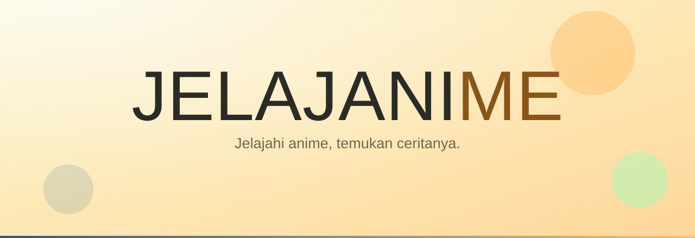
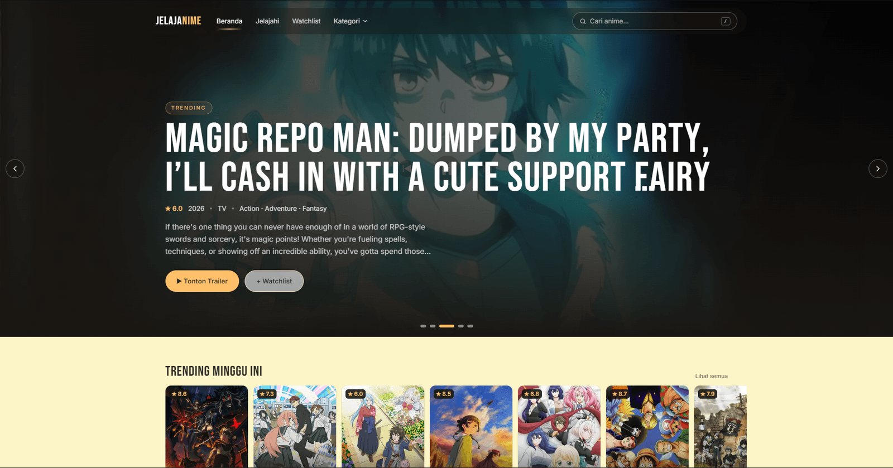
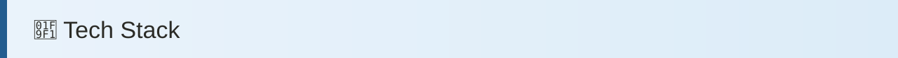
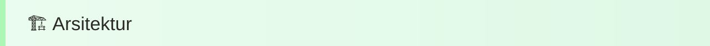

<p align="center">
  <strong>Jelajahi anime, temukan ceritanya.</strong><br/>
  Katalog anime modern berbahasa Indonesia — cepat, sinematik, sepenuhnya responsif.<br/>
  Data dari AniList. Hanya menautkan sumber streaming legal.
</p>

<p align="center">
  <a href="https://jelajanime.vercel.app"></a>
  <a href="https://github.com/abexziero/jelajanime"></a>
</p>

<p align="center">
  
  
  
  
  
  
</p>

<p align="center"></p>
<p align="center"><sub>Beranda — hero carousel dengan latar video trailer.</sub></p>


<table>
  <tr>
    <td><strong>Beranda sinematik</strong><br/>Hero carousel 5 anime trending, latar video trailer, auto-rotate, jeda saat hover.</td>
    <td><strong>Detail lengkap</strong><br/>Meta, genre, sinopsis, karakter, daftar episode, rekomendasi.</td>
  </tr>
  <tr>
    <td><strong>Pencarian instan</strong><br/>Command-bar di navbar (<code>/</code>), debounce 300 ms, saran poster.</td>
    <td><strong>Jelajahi / Browse</strong><br/>Filter genre, format, status, tahun + pagination.</td>
  </tr>
  <tr>
    <td><strong>Watchlist</strong><br/>Tersimpan di <code>localStorage</code>, sinkron antar-tab.</td>
    <td><strong>Trailer modal</strong><br/>Pemutar <code>youtube-nocookie</code> di dialog native.</td>
  </tr>
</table>


<p align="center"></p>
<p align="center"><sub>Beranda — hero carousel dengan latar video trailer.</sub></p>



<table>
  <tr><th>Lapisan</th><th>Teknologi</th></tr>
  <tr><td>Framework</td><td><strong>Next.js 16</strong> (App Router, Turbopack, PPR)</td></tr>
  <tr><td>UI</td><td><strong>React 19</strong> + <strong>TypeScript</strong></td></tr>
  <tr><td>Styling</td><td><strong>Tailwind CSS v4</strong> (token <code>@theme</code>)</td></tr>
  <tr><td>Animasi</td><td><strong>GSAP 3</strong> + <code>@gsap/react</code></td></tr>
  <tr><td>Data</td><td><strong>AniList GraphQL API</strong> (tanpa API key)</td></tr>
  <tr><td>Deploy</td><td><strong>Vercel</strong> (auto-deploy dari GitHub)</td></tr>
</table>



```text
UI (App Router) → CatalogProvider → adapter anilist → AniList GraphQL API
```

Provider-agnostik: UI terpisah dari sumber data. Ganti sumber = buat adapter baru.


```bash
npm install      # .npmrc sudah mengatasi allow-scripts
npm run dev      # http://localhost:3000
npm run lint     # eslint
npm run typecheck
npm run build
```

---

Data anime dari [AniList](https://anilist.co). Jelajanime tidak berafiliasi dengan AniList dan **tidak** meng-host video berhak cipta — tautan tonton mengarah ke layanan resmi berlisensi.
